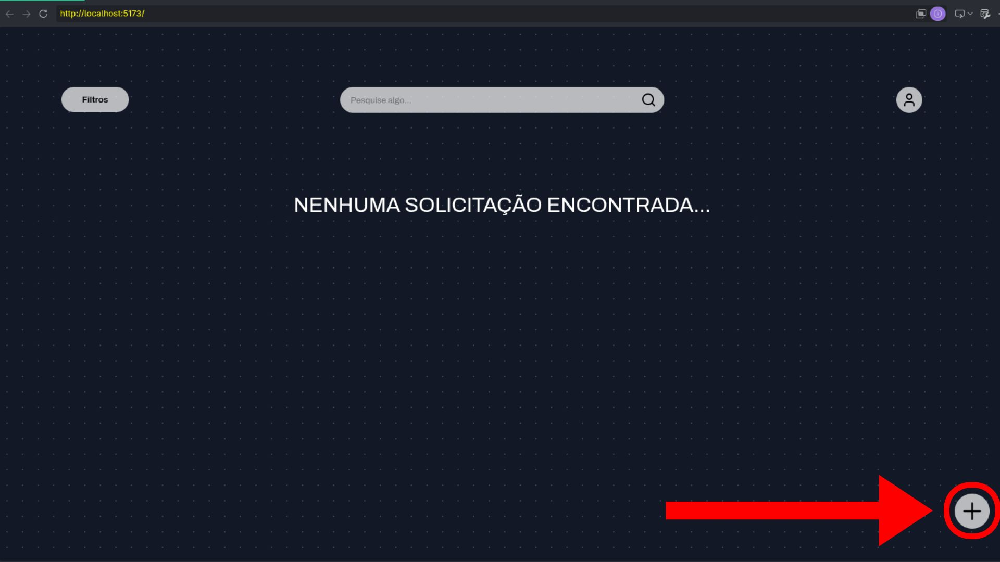
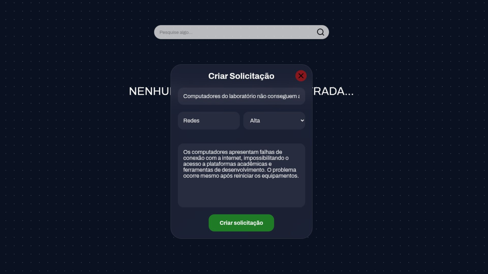
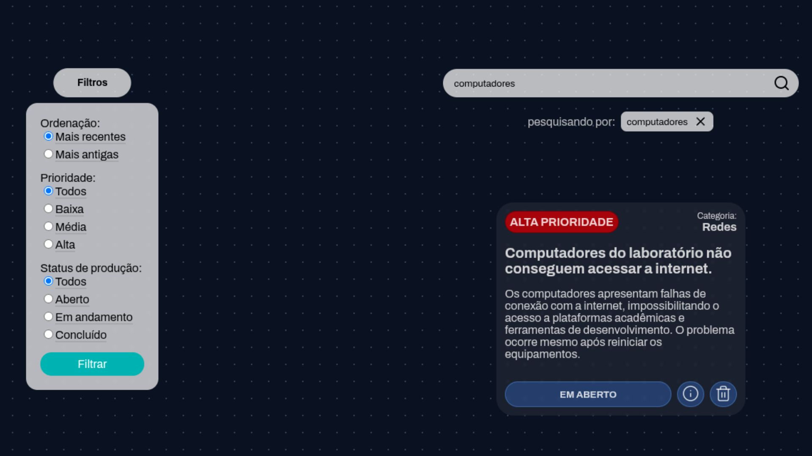
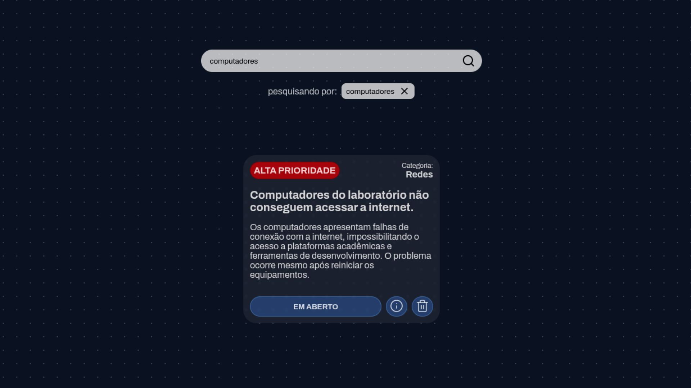
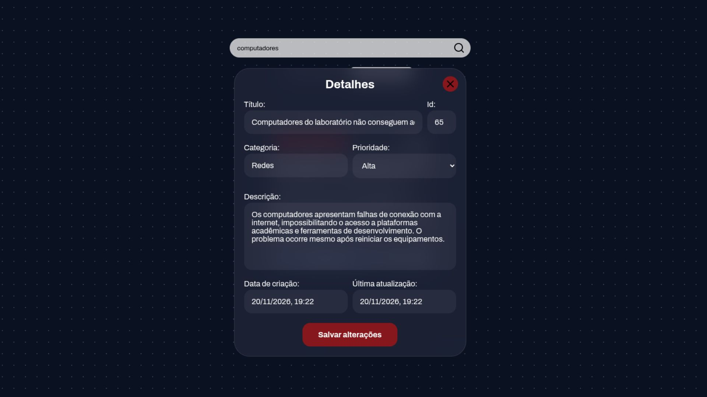

# Central de Solicitações

Aplicação web full stack para registrar solicitações internas e acompanhar sua resolução: interface em React, API REST em Node.js e persistência em PostgreSQL.

## Interface

|                         Tela inicial                         |                             Criação                             |                       Filtros e busca                        |
| :----------------------------------------------------------: | :-------------------------------------------------------------: | :----------------------------------------------------------: |
|  |  |  |

|                       Ações do card                        |                       Edição                        |
| :--------------------------------------------------------: | :-------------------------------------------------: |
|  |  |

Na primeira execução não há solicitações cadastradas. O botão **+** no canto inferior direito abre o formulário de criação. Na parte inferior de cada card é possível avançar o status, abrir os detalhes (onde a solicitação é editada) e excluí-la.

## Tecnologias

**Back-end:** Node.js, TypeScript, Express, Zod (validação), Prisma 7 (ORM) e PostgreSQL 18.
**Front-end:** React, TypeScript e Vite.
**Infraestrutura:** Docker Compose (apenas o banco de dados).

## Funcionalidades

**Requisitos obrigatórios**

- **RF01 – Cadastro:** título, descrição, categoria e prioridade (baixa, média ou alta). O status inicial é sempre `Aberta`, definido pela API.
- **RF02 – Consulta:** listagem e consulta de uma solicitação por id.
- **RF03 – Filtros:** por status e por prioridade.
- **RF04 – Regra de negócio:** o status segue `Aberta → Em andamento → Concluída`, sem saltar etapas. A regra é aplicada na API.
- **RF05 – Persistência:** dados em PostgreSQL, mantidos após reiniciar a aplicação (volume nomeado no Docker).
- **RF06 – Integração e validação:** a interface consome a API. Campos vazios e transições inválidas são rejeitados com mensagem compreensível.

**Opcionais implementados**

- Busca textual
- Ordenação crescente e decrescente
- Edição de título, descrição, categoria e prioridade
- Exclusão

## Pré-requisitos

- Node.js (testado com a v24)
- Docker e Docker Compose

## Como executar

```bash
git clone https://github.com/JefersonMesquita/central-solicitacoes.git
cd central-solicitacoes
```

**1. Banco de dados**

```bash
cp .env.example .env
docker compose up -d
```

**2. API** (em um terminal)

```bash
cd backend
cp .env.example .env
npm install
npx prisma generate
npx prisma migrate deploy
npm run dev
```

A API sobe em `http://localhost:3000`.

**3. Interface** (em outro terminal)

```bash
cd frontend
cp .env.example .env
npm install
npm run dev
```

Acesse `http://localhost:5173`.

Os arquivos `.env.example` já trazem valores que funcionam localmente, então não é preciso editar nada. Se mudar a porta, o usuário ou a senha do banco, altere também a `DATABASE_URL` em `backend/.env`.

Para encerrar o banco, use `docker compose down`. **Não** use a opção `-v`, porque ela apaga os dados.

**Problemas comuns**

- _Porta 5432 ocupada:_ altere `DB_PORT` no `.env` da raiz e a porta na `DATABASE_URL` do `backend/.env`.
- _`DATABASE_URL is not set`:_ o `backend/.env` não foi criado, ou o comando foi executado fora da pasta `backend`.
- _Erro de conexão ao rodar a migration:_ aguarde o container ficar saudável (`docker compose ps`) e tente de novo.

## API

Prefixo: `/api`

| Método | Rota           | Descrição                                                                                                      |
| ------ | -------------- | -------------------------------------------------------------------------------------------------------------- |
| POST   | `/request`     | Cria uma solicitação                                                                                           |
| GET    | `/request`     | Lista, com filtros `status` e `priority`, ordenação `order` e busca (⚠️ confirme o nome do parâmetro de busca) |
| GET    | `/request/:id` | Consulta uma solicitação                                                                                       |
| PUT    | `/request/:id` | Edita título, descrição, categoria e prioridade                                                                |
| PATCH  | `/request/:id` | Altera o status, respeitando o fluxo                                                                           |
| DELETE | `/request/:id` | Exclui uma solicitação                                                                                         |

Valores aceitos: `priority` em `LOW`, `MEDIUM` ou `HIGH`; `status` em `OPEN`, `IN_PROGRESS` ou `COMPLETED`; `order` em `asc` ou `desc`.

**Fluxo de status:** o cliente envia o status desejado (`{ "status": "IN_PROGRESS" }`), e a API só aceita o próximo da sequência. Saltos, retrocessos e repetições retornam `409`. O status não pode ser alterado pela edição (PUT).

**Erros** seguem um formato único:

```json
{
  "error": {
    "message": "Dados inválidos.",
    "details": [{ "field": "category", "message": "A categoria é obrigatória" }]
  }
}
```

- `400`: dados inválidos (campos vazios, valores fora do permitido, id malformado)
- `404`: solicitação não encontrada
- `409`: transição de status inválida

## Banco de dados

PostgreSQL 18, gerenciado pelo Prisma. O schema fica em `backend/prisma/schema.prisma` e as migrations versionadas em `backend/prisma/migrations/`. O banco tem uma única tabela.

### Tabela `service_requests`

| Coluna        | Tipo                 | Regras                                                           |
| ------------- | -------------------- | ---------------------------------------------------------------- |
| `id`          | inteiro              | chave primária, autoincremento                                   |
| `title`       | `VARCHAR(200)`       | obrigatório                                                      |
| `description` | `TEXT`               | obrigatório                                                      |
| `category`    | `VARCHAR(100)`       | obrigatório                                                      |
| `priority`    | enum `Priority`      | obrigatório: `LOW`, `MEDIUM` ou `HIGH`                           |
| `status`      | enum `RequestStatus` | obrigatório, padrão `OPEN`: `OPEN`, `IN_PROGRESS` ou `COMPLETED` |
| `created_at`  | `TIMESTAMPTZ`        | preenchido na criação                                            |
| `updated_at`  | `TIMESTAMPTZ`        | atualizado a cada alteração                                      |

A regra de transição de status é aplicada pela API (camada de serviço), e não por uma constraint do banco.

### Persistência

Os dados ficam em um volume nomeado do Docker (`requestflow_postgres_data`), então sobrevivem a `docker compose down`. Só o `docker compose down -v` os apaga.

## Estrutura do projeto

```
central-solicitacoes/
├── docker-compose.yml        # PostgreSQL
├── readme-assets/            # capturas de tela do README
├── backend/
│   ├── prisma/               # schema e migrations
│   ├── src/
│   │   ├── controllers/      # HTTP: valida a entrada com Zod e escolhe a resposta
│   │   ├── services/         # regras de negócio e acesso ao banco
│   │   ├── schemas/          # schemas Zod
│   │   ├── middlewares/      # tratamento global de erros
│   │   ├── lib/              # instância do Prisma Client
│   │   ├── router.ts         # definição das rotas
│   │   ├── app.ts            # configuração do Express
│   │   └── server.ts         # inicialização do servidor
│   └── ...
└── frontend/
    ├── src/
    │   ├── api/              # chamadas à API
    │   ├── components/       # Forms, Header e RequestCard (cada componente com seu .tsx e seu .module.css)
    │   ├── contexts/         # estado compartilhado (solicitações e filtros)
    │   ├── types/            # tipos das solicitações
    │   ├── App.tsx           # tela principal, que reúne os componentes
    │   ├── index.css         # estilos globais
    │   └── ...
    └── ...
```

## Decisões e limitações

- **PostgreSQL com Docker** em vez de SQLite, por aproximar o ambiente de um cenário real e facilitar a evolução do projeto. O custo é exigir Docker.
- **Sem autenticação** não implementado (o icone de usuário no canto superior direito não faz nada).
- **Sem testes automatizados.** A verificação foi manual, com requisições à API e uso da interface.
- **Sem paginação** na listagem.

## Uso de inteligência artificial

Utilizei o Claude (Anthropic) como ferramenta de apoio durante o desenvolvimento: para esclarecer dúvidas técnicas, revisar código e gerar trechos de implementação, que foram revisados, adaptados e testados por mim. Também o utilizei para redigir este README. Consigo explicar e justificar o funcionamento e as decisões do projeto.
